# Hệ Thống Audio - Sơ Đồ Kiến Trúc

## Tổng Quan Architecture

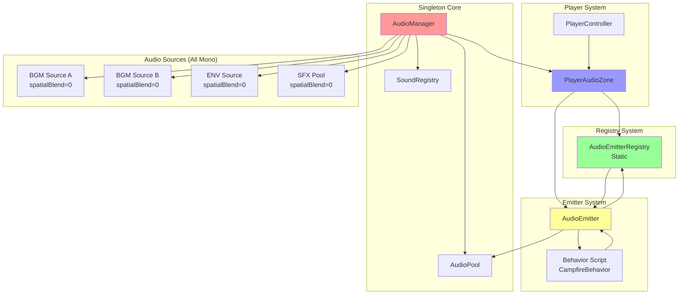

---

## Component Relationships

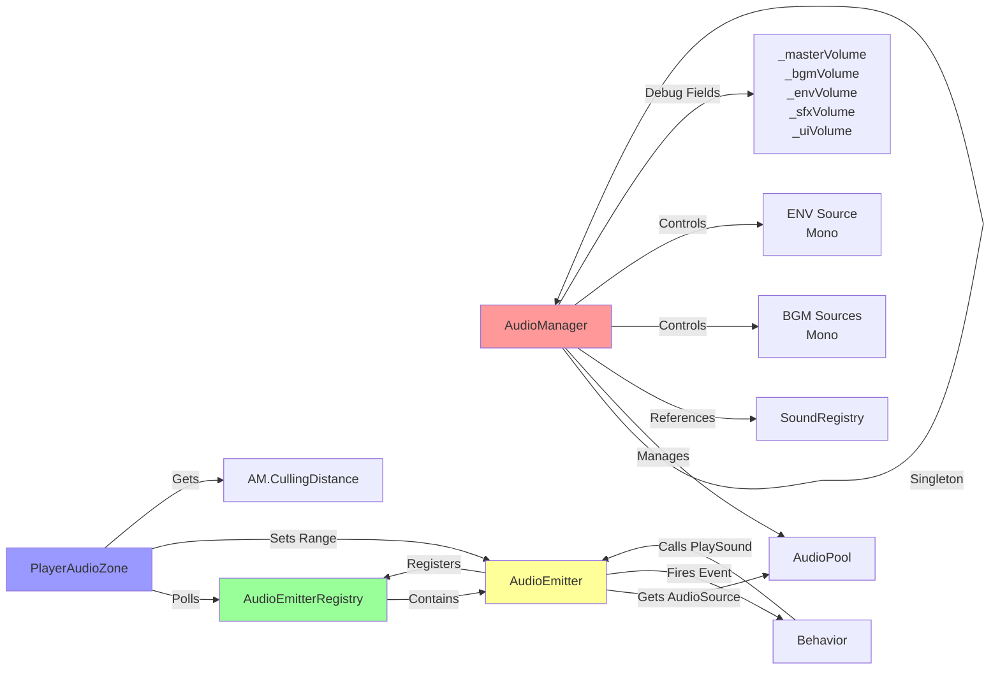

---

## Data Flow - Startup

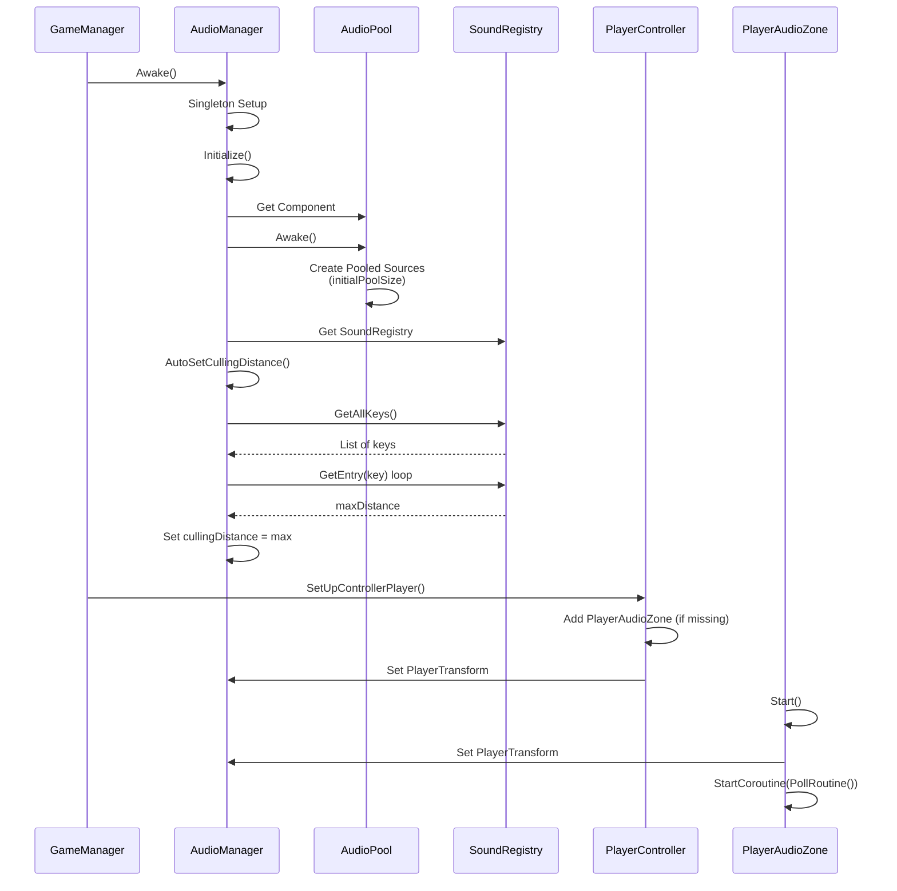

---

## Data Flow - AudioEmitter Registration

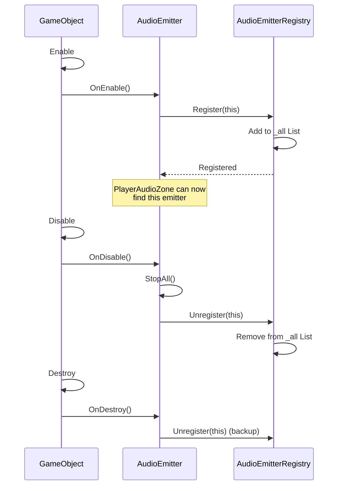

---

## Data Flow - Distance Culling

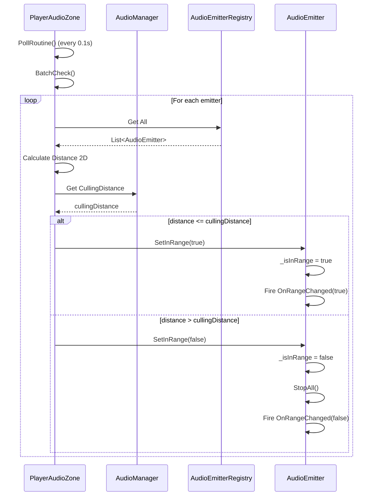

---

## Data Flow - Loop Sound (Campfire Example)

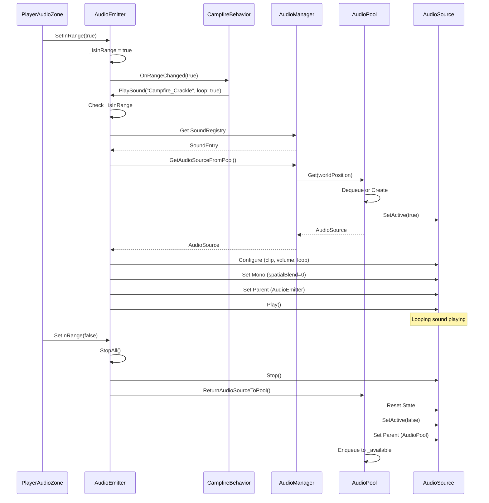

---

## Data Flow - One-Shot Sound

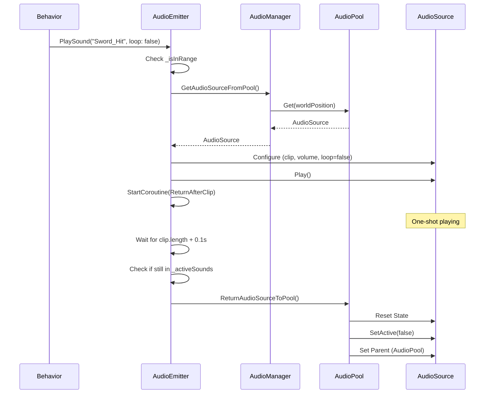

---

## Audio Pool Lifecycle

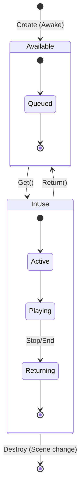

---

## Distance Culling Logic

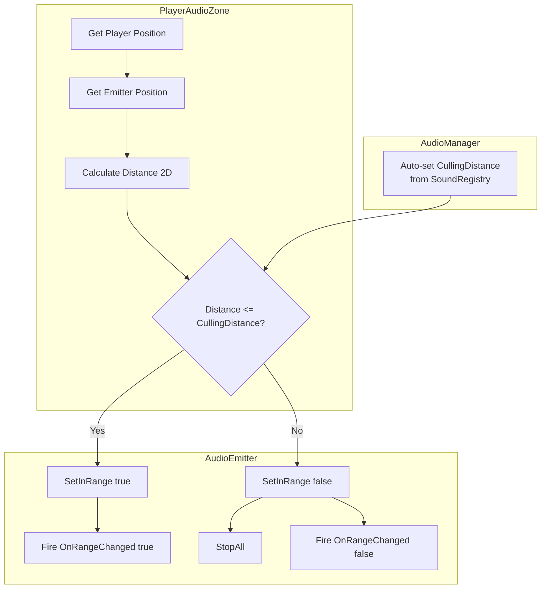

---

## Sound Attenuation Curve

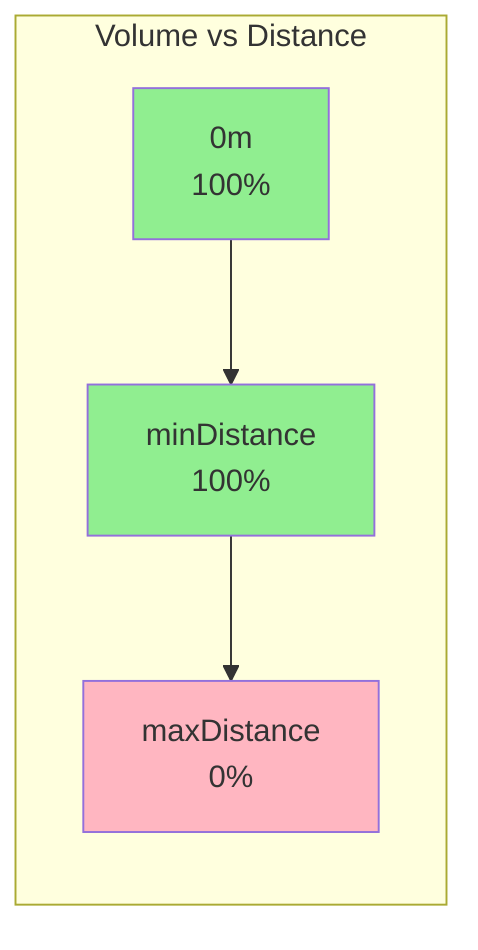

**Custom Rolloff Curve**:
```csharp
curve.AddKey(0f,        1f); // Full volume tại 0
curve.AddKey(minDistance, 1f); // Full volume trong minDistance
curve.AddKey(maxDistance, 0f); // Volume về 0 tại maxDistance
```

---

## Event-Driven Loop Sound

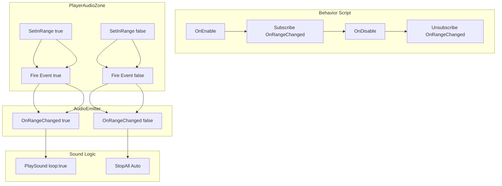

---

## Performance Optimization

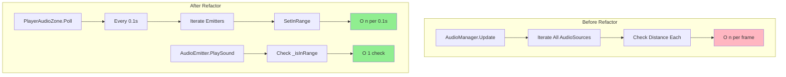

---

## File Structure

```
Assets/Script/Audio/
├── Manager/
│   └── AudioManager.cs
│       ├── Singleton Pattern
│       ├── AudioPool Management
│       ├── BGM Crossfade (with _bgmVolume field)
│       ├── ENV Control (with _envVolume field)
│       ├── VolumeSettings (PlayerPrefs)
│       ├── Debug Volume Fields (_master, _bgm, _env, _sfx, _ui)
│       ├── Force Mono Audio (spatialBlend=0)
│       └── CullingDistance Auto-set
│
├── Helper/
│   ├── AudioPool.cs
│   │   ├── Object Pooling (Mono: spatialBlend=0)
│   │   ├── Get/Return API
│   │   └── Debug Count
│   │
│   ├── AudioEmitterRegistry.cs
│   │   ├── Static Class
│   │   ├── Register/Unregister
│   │   └── All List
│   │
│   ├── AudioEmitter.cs
│   │   ├── Register/Unregister
│   │   ├── SetInRange
│   │   ├── OnRangeChanged Event
│   │   ├── PlaySound/StopSound (Mono Mode)
│   │   └── Loop Support
│   │
│   ├── PlayerAudioZone.cs
│   │   ├── Poll Routine
│   │   ├── BatchCheck
│   │   ├── Distance 2D Calculation
│   │   └── Gizmo Visualization
│   │
│   └── AudioTest.cs
│       ├── Test Utility
│       ├── Auto-select Key
│       └── Debug Log
│
├── Data/
│   └── SoundRegistry.cs
│       ├── SoundEntry Dictionary
│       ├── GetEntry API
│       └── GetAllKeys API
│
└── Example/
    └── CampfireBehavior.cs
        ├── OnRangeChanged Subscribe
        └── Loop Sound Pattern
```

---

## Key Concepts Summary

### Registry + Poll Architecture
- AudioEmitterRegistry: Static registry lưu danh sách emitter
- PlayerAudioZone: Poll registry mỗi 0.1s để check distance
- Không dùng Update() O(n) trong AudioManager

### Event-Driven Range Changes
- AudioEmitter.OnRangeChanged event
- Behavior scripts subscribe để phát/dừng loop sound
- Auto-stop khi ra vùng

### Object Pooling
- AudioPool tái sử dụng AudioSource
- Tránh tạo/hủy GameObject tốn CPU/GC
- Giới hạn maxPoolSize để tránh overflow

### Distance Culling
- cullingDistance: Global threshold để quyết định phát hay không
- maxDistance: Per-sound attenuation
- Auto-set cullingDistance từ SoundRegistry

### Mono Audio Architecture
- Tất cả AudioSources: `spatialBlend = 0f` (2D)
- Không có 3D positioning hay stereo panning
- Volume controlled qua fields trong AudioManager

### Debug Volume Fields
- `_masterVolume`, `_bgmVolume`, `_envVolume`, `_sfxVolume`, `_uiVolume`
- Hiển thị trong Inspector để debug
- Được cập nhật khi `SetVolumeForChannel()` được gọi
